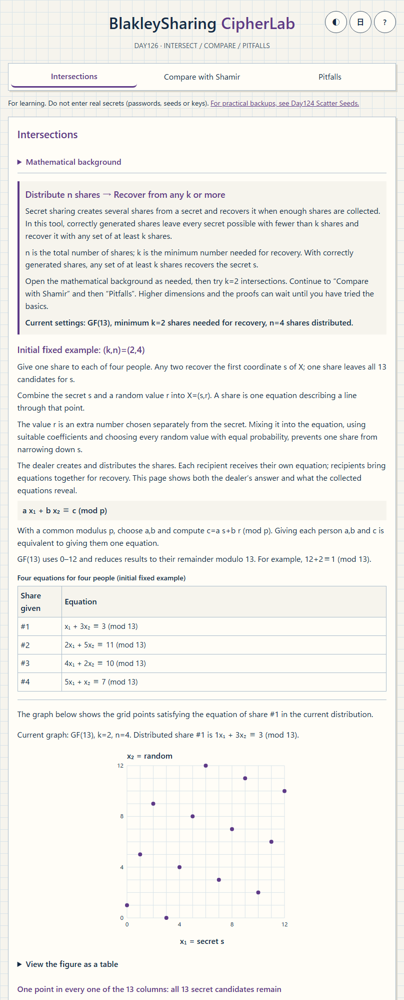
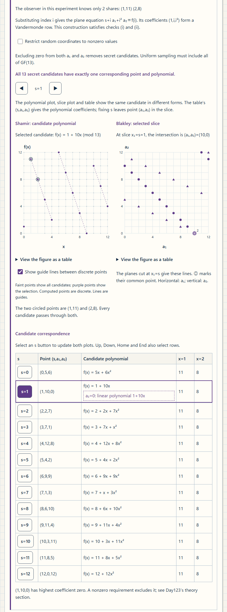
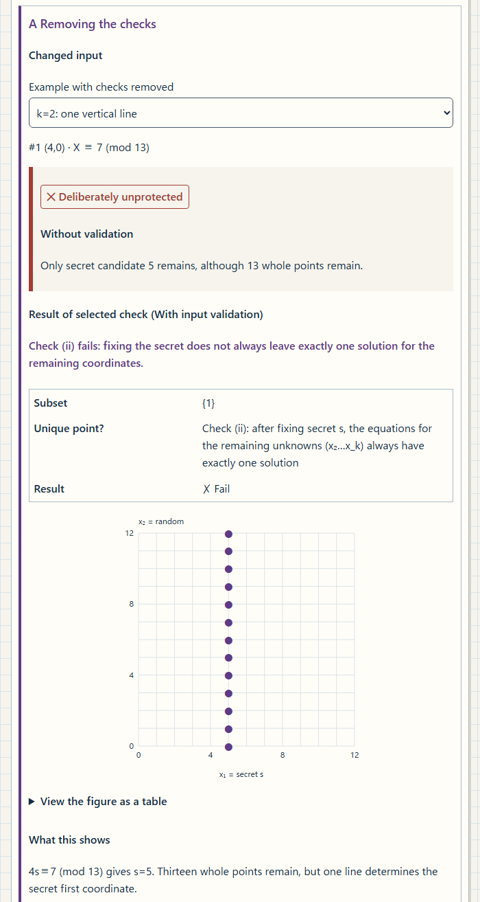

English · [日本語](README.md)

# BlakleySharing CipherLab - Learn secret sharing through intersections and candidate secrets

[](https://github.com/ipusiron/blakley-sharing-cipherlab/stargazers)
[](https://github.com/ipusiron/blakley-sharing-cipherlab/forks)
[](https://github.com/ipusiron/blakley-sharing-cipherlab/commits)
[](LICENSE)
[](https://ipusiron.github.io/blakley-sharing-cipherlab/)

> **Day126 - 200 Security Tools with Generative AI**

BlakleySharing CipherLab is an educational tool for learning secret-sharing conditions through finite-field line and plane intersections.
Select shares, compare whole-point candidates with first-coordinate secret candidates, and trace their correspondence with Shamir polynomials.

Secret sharing creates several shares from a secret and recovers the original value when enough shares are collected.
A share is information given to a recipient; in this tool, it is one equation. With suitable coefficients and randomness, fewer than k shares do not narrow the secret, while any set of at least k shares recovers it.

For learning only. Do not enter actual secrets, including passwords, seed phrases or keys.
For a practical backup workflow, see [Day124 Scatter Seeds][day124].
In the tool, this notice and link appear in Help.

## 🌐 Demo

👉 [Open BlakleySharing CipherLab](https://ipusiron.github.io/blakley-sharing-cipherlab/)

Use it in a browser, or open the downloaded `index.html` directly through `file://`. No build is required.
The controls at the top right switch between Japanese and English, and between light and dark themes.
A saved theme choice takes priority; without a valid saved value, the theme follows the OS setting when the page opens.
Each language or theme button stores only its own preference.

During startup, Japanese explanations and bilingual preparation messages appear first, with interactive controls disabled until initialization finishes.
Successful initialization opens the normal interface and enables the language and theme controls.
If JavaScript is disabled or a required file cannot load, the explanatory text, expandable sections and reload link remain available.

## 📸 Screenshots

These screenshots use the English interface and light theme. Each caption explains what the displayed state shows.



> *A dealer and four recipients follow preparation, equation creation, distribution and recovery. Mixing the secret with randomness gives the remainder c=3, which becomes part of share (1,3,3).*



> *The observer knows only shares (1,11) and (2,8). All 13 rows have f(1)=11 and f(2)=8. Select a row to compare candidates consistent with those same two shares.*



> *Card A in “Pitfalls” compares the unchecked model’s output with the result of validating its inputs.*

## ✨ Features

| View | Operations and observations |
| --- | --- |
| Intersections (k=2) | Follow k=2 lines and their intersection on a finite-field coordinate plane |
| Planes (k=3) | Real 3D introduction and finite-field slices for k=3 |
| Compare with Shamir secret sharing | Rewrite Shamir shares as line or plane equations and compare candidate polynomials with coefficient points |
| Pitfalls | Compare four deliberately unsafe models: whole-point secrets, integers and narrow randomness, missing checks, and tampering |
| Help and lessons | Ten illustrated sections with sources, covering the original paper, perfect secrecy and linear secret sharing |

Available fields are GF(7), GF(11) and GF(13). The lines tab fixes k at 2 and the planes tab fixes it at 3, with share counts `k≤n≤min(8,p−1)`.
Normals are generated by “Randomness + checks” or “From indices (Vandermonde)”, which builds coefficient rows (1,i,i²,…) from index i. Select any number of shares from zero to n.
For k=2, edit right-hand values or normal components to observe coincident lines and vertical lines that reveal the secret.

## 📖 Usage and fixed examples

For a first visit, open the mathematical background as needed and try k=2 intersections.
Continue to “Compare with Shamir secret sharing” for the candidate correspondence, then change conditions in “Pitfalls”. The k=3 plane view and proofs can wait until after the basics.
Help includes a glossary and reading route. Start with Sections 1, 4 and 7 for the scheme, candidate counts and range of randomness.

### Intersections (k=2)

“Mathematical background” appears first and starts collapsed. It can be opened at any value of k.
Its fixed GF(13) example compares real numbers, integers and congruences, independently of the experiment settings and edited shares below.
The integer graph shows four points with coordinates in 0–12 satisfying `x₁+3x₂=29`.
The modular graph checks all grid points in that range for `x₁+3x₂≡3 (mod 13)`, giving 13 points.

Step 3 defaults to “Wrap the original line”, with guides visible.
Extend the descending line from step 1 beyond the graph and wrap both axes with period 13.
Extracting the integer-coordinate points on the wrapped line gives 13 points. On the original line, integer points run right 3 and down 1.
For example, `(14,5)→(1,5)` and `(32,−1)→(6,12)`. Wrapping only step 2’s four points cannot add points, so include those outside the graph.
“Alternative: plot in x₁ order” uses `x₂≡1+4x₁ (mod 13)` to move right 1 and up 4, wrapping x₂ modulo 13.
This is easier to plot because points follow horizontal-axis order, x₁=0–12, as in `(0,1)→(1,5)→(2,9)→(3,0)`.
The guide paths differ, but the set of points is the same. They do not represent continuous lines between points in GF(13).

n is the total share count, and k is the minimum number needed for recovery. Correctly generated shares allow recovery from any set of at least k shares.
The introduction before the graph explains this relationship and shows the current p, k and n.
The initial (2,4) example gives one share to each of four people, with any two sufficient for recovery.
The fixed example introduces a dealer and four recipients, then follows preparation of the secret and randomness, equation creation, distribution and recovery.
The secret s=5 and random value r=8 form X=(5,8). Each share includes c, calculated by mixing the secret with the random value.
For #1, 1×5+3×8=29 leaves the remainder c=3 when divided by 13. The table pairs the actual share (a,b,c)=(1,3,3) with its equation.
Examples satisfying s+3r≡3 explain why one share leaves the secret unknown: every s produces c=3 with the same probability.
In the initial graph, every horizontal-coordinate column from 0 to 12 contains one point. Since no column is empty, none of the 13 secret candidates can be ruled out.
Accordion headers and expanded content have distinct backgrounds and borders that mark the end of each region.
Although the page also shows the dealer’s answer, candidate counts describe what follows from only the collected shares and known generation rules.

The fixed coefficient pairs are #1:(1,3), #2:(2,5), #3:(4,2), and #4:(5,1). The # labels identify shares and are not used to calculate a or b.
For k=2, every b must be nonzero and no two pairs may be multiples modulo 13. Together with independent, uniform r, these conditions protect s with one share and determine the point with two.
“Check coefficient choices with examples and a formula” explains why twice #1, (2,6), adds no new constraint and shows the calculation using the actual #2=(2,5).
Coefficients are chosen independently of secret and random-coordinate values; they may be fixed, public and reused. Each new sharing needs a fresh, independent, uniform r.
The same accordion introduces random selection from eligible candidates and the Vandermonde rule (a,b)=(1,i) for k=2.

Combine secret s and random value r into `X=(s,r)`. The value r is an extra number chosen separately from the secret.
Suitable coefficients and randomness sampled with equal probability from the entire field keep one equation from narrowing down s.
Each share is a line through that point: `a x₁+b x₂≡c (mod p)`.
Choose a,b and calculate `c=a s+b r (mod p)`. With a common modulus p, giving a,b and the right-hand value c is equivalent to giving one equation.
GF(p) uses 0 through p−1, reducing results to their remainder modulo p.
All four initial equations are visible before the graph, connecting distribution to geometry. These equations are a fixed teaching example.
Within each tab, change p, n, s and other settings to explore the example. The initial (2,4) distribution example for four recipients appears only in “Intersections (k=2)”.

The initial example uses GF(13), `k=2`, `n=4` and `X=(5,8)`. The secret is its first coordinate, `s=5`.
Share #1 alone leaves 13 points satisfying `x₁+3x₂≡3 (mod 13)`.
Stepping through candidates tries a value of s and its corresponding random coordinate. It does not enter the answer or change the distributed values.
Press a share button to add or remove its equation. Adding #2 determines the single point `(5,8)`.
Numbers on points count the equations meeting there. With zero shares, all points remain candidates, but the graph is blank because no share’s points have been drawn.
Editing right-hand value c or coefficient b changes only the experimental copy. The value read from the altered intersection may differ from the original secret.
Move the mouse over a coordinate graph to display the nearest grid point’s coordinates. Leave the graph or press Escape to clear the display.
Keyboard users can read the values through “View the figure as a table”. Touch interaction preserves vertical scrolling over graphs.

<!-- example: default-k2 -->

| Share | Normal (a₁,a₂) | c (mod 13) | Integer right-hand value |
| --- | --- | --- | --- |
| #1 | (1,3) | 3 | 29 |
| #2 | (2,5) | 11 | 50 |
| #3 | (4,2) | 10 | 36 |
| #4 | (5,1) | 7 | 33 |

The dealer settings contain the answer and generation controls. Changing p, n or s regenerates the shares.
Each row of the distribution table shows the share given to one recipient: the coefficients in order, followed by the right-hand value c. The modulus p is shared by everyone.
If reducing p puts s or n outside the supported range, a message explains the adjustment and gives both the old and new values.
“Generate with fresh randomness” keeps s and samples the random coordinates again. “Randomness + checks” also chooses new coefficients and reports the attempt count. With “From indices”, the same p, k and n give the same coefficients.
Editing a random coordinate keeps s and the coefficients, and recalculates c for every share. Manual entry does not establish uniform random sampling. Resizing the screen preserves the value being typed; calculations update when the input is committed.
“Restore all edited copies” discards changes to every share’s copy and restores the originally distributed values.
Normal checks examine every relevant subset. Check (i) covers recovery with k shares; check (ii) tests the coefficients needed to protect s with k−1, under the randomness assumptions.
Open the collapsible details to read the equations and checks.

### Planes (k=3)

The “Planes (k=3)” tab extends the experiment to points with three coordinates.
Switching between it and “Intersections (k=2)” preserves each experiment’s selected shares, candidate and “Failures only” setting. “Restore this tab’s default example” returns the lines tab to k=2 and the planes tab to k=3.

The fixed k=3 example uses GF(11) and `X=(7,2,9)`. Shares #1 and #2 leave one point in each of the 11 secret slices.
Adding #3 leaves only `(x₂,x₃)=(2,9)` in the `s=7` slice.

<!-- example: default-k3 -->

| Share | Normal (a₁,a₂,a₃) | c (mod 11) |
| --- | --- | --- |
| #1 | (1,2,3) | 5 |
| #2 | (4,1,5) | 9 |
| #3 | (2,7,1) | 4 |
| #4 | (3,1,1) | 10 |
| #5 | (1,1,3) | 3 |

The real-number 3D view is an introduction. It follows the same s selection as the finite-field slices, but intersection coordinates can differ.
Read finite-field candidate counts from the GF(p) slices and tables. The real view uses integer right-hand values.
Changing plane visibility does not change how many shares are used in calculations.
Each slice tile fixes s and shows only common candidates. The large graph also plots points from individual equations, so points may remain there when a tile says “No points”.
With two or more shares selected, double circles and the overlap count identify candidates common to all equations. If the recovered s differs from the slice being viewed, use the button to go to the recovered slice.

### Compare with Shamir secret sharing

For example, Shamir’s scheme uses `f(x)=s+a₁x`, placing the secret at `f(0)=s`.
Each recipient gets a nonzero index i and value f(i). The coefficient a₁ is random; for k=3, another random coefficient a₂ gives `f(x)=s+a₁x+a₂x²`.
The distributed share includes f(i), a value calculated by mixing the secret with the randomness; s, a₁ and a₂ are not given out directly.
Arrange coefficients as coordinates to define X=(s,a₁) for k=2 and X=(s,a₁,a₂) for k=3. X differs from a share point (i,f(i)).
Share (2,8) gives f(2)=8, which becomes s+2a₁+4a₂≡8 and then x₁+2x₂+4x₃≡8 (mod 13), a plane condition through X.
In this comparison, its coefficients (1,i,i²) can be calculated from the index i.

The k=2 dealer’s answer is `f(x)=5+4x (mod 13)`, matching the introduction in [Day123 ShamirSharing CipherLab][day123].
The observer knows only (1,9). The 13 candidate lines through this point correspond to the 13 points `(s,a₁)` satisfying `s+a₁≡9`.
The following table lists all five dealer shares for reference. In the interface, all distributed values and the original polynomial are kept separately under “View the dealer’s answer”.

<!-- example: shamir-k2 -->

| i | f(i) (mod 13) |
| --- | --- |
| 1 | 9 |
| 2 | 0 |
| 3 | 4 |
| 4 | 8 |
| 5 | 12 |

For k=3, the dealer’s answer `f(x)=5+4x+2x² (mod 13)` has coefficient point `X=(5,4,2)`.
The observer knows only (1,11) and (2,8), fewer than the three shares required. The following 13 points and 13 polynomials fit those two shares.
Select an s row to update the polynomial and slice plots together. Each is another representation of the same candidate.

<!-- example: shamir-k3 -->

| s | (s,a₁,a₂) | Candidate polynomial (mod 13) | f(1) | f(2) |
| --- | --- | --- | --- | --- |
| 0 | (0,5,6) | `f(x)=5x+6x^2` | 11 | 8 |
| 1 | (1,10,0) | `f(x)=1+10x` | 11 | 8 |
| 2 | (2,2,7) | `f(x)=2+2x+7x^2` | 11 | 8 |
| 3 | (3,7,1) | `f(x)=3+7x+x^2` | 11 | 8 |
| 4 | (4,12,8) | `f(x)=4+12x+8x^2` | 11 | 8 |
| 5 | (5,4,2) | `f(x)=5+4x+2x^2` | 11 | 8 |
| 6 | (6,9,9) | `f(x)=6+9x+9x^2` | 11 | 8 |
| 7 | (7,1,3) | `f(x)=7+x+3x^2` | 11 | 8 |
| 8 | (8,6,10) | `f(x)=8+6x+10x^2` | 11 | 8 |
| 9 | (9,11,4) | `f(x)=9+11x+4x^2` | 11 | 8 |
| 10 | (10,3,11) | `f(x)=10+3x+11x^2` | 11 | 8 |
| 11 | (11,8,5) | `f(x)=11+8x+5x^2` | 11 | 8 |
| 12 | (12,0,12) | `f(x)=12+12x^2` | 11 | 8 |

<!-- example: nonzero -->

The candidate `(1,10,0)` has `a₂=0` and represents the linear polynomial `1+10x`.
Restricting only the highest coefficient to nonzero values removes that candidate.
This tool’s nonzero-randomness switch restricts both a₁ and a₂: it removes `s=1` and `s=12`, reducing 13 candidates to 11.
Finite-field points are discrete; the connecting guide lines merely help follow their sequence.

### Pitfalls

Cards appear in the order B, C, A and D. Read the purpose, change the input, then compare the result and its explanation.
B compares a whole-point secret with a first-coordinate secret; C compares generation rules. A and D contrast unchecked routines with checks on the equations.

- B: when the whole point is secret, each independent share divides the candidate count by p
- C: integer ranges and narrow randomness reduce the secret’s candidate set
- A: missing checks can reveal the secret or return a value even when no unique point is determined
- D: alter #2’s right-hand value and compare detection and identification at different share counts

In B, increase the share count from zero and compare how whole-point and first-coordinate candidates decrease.
The whole-point count measures coordinate tuples; the secret count measures distinct first-coordinate values. At k=3, two shares leave 11 points but all 11 values of s from 0–10.
Each slice tile fixes s. Add the dots across all tiles to count whole points; count nonempty tiles to count secret candidates.
These tiles are for viewing. In “Planes (k=3)”, selecting a tile enlarges its slice.
C’s comparison scheme distributes modulo 13 from the outset and samples randomness uniformly over all of GF(13). A later check does not erase information already revealed.
The integer example keeps `X=(5,8)`, restricts coordinates to 0–12, and distributes right-hand values without reducing them modulo 13.

<!-- example: integer -->

| Share | Integer right-hand value | Candidate secrets s |
| --- | --- | --- |
| #1 | 29 | {2,5,8,11} |
| #2 | 50 | {0,5,10} |
| #3 | 36 | {3,4,5,6,7,8,9} |
| #4 | 33 | {5,6} |

Share #1 imposes the congruence `s≡2 (mod 3)`, while #4 restricts candidates through the random coordinate’s range.
The narrow-randomness example is a separate fixed example generated with `x₂∈{0,1,2,3}`. One share leaves these four secrets:

<!-- example: narrow -->

| Generated X | Normal | c (mod 13) | Candidate secrets s |
| --- | --- | --- | --- |
| (0,1) | (1,3) | 3 | {0,3,7,10} |

<!-- example: leak3 -->

Card A’s k=3 example uses normals `(1,2,3)` and `(5,4,6)`, with right-hand values `c=(5,9)`.
Subtracting twice the first equation from the second gives `3s≡10 (mod 11)`, determining `s=7`.
11 whole points still remain, so nonuniqueness of the point alone does not establish secrecy.
Card A’s coincident-line case repeats one condition despite having two shares. Cramer’s calculation and the pass-rate figures remain under “Calculation details”, separate from the visible basic explanation.

Card D changes the initial example’s share #2 right-hand value from 11 to 12.

<!-- example: tamper -->

| Selected pair | Reconstructed X | s |
| --- | --- | --- |
| #1 + #2 | (8,7) | 8 |
| #1 + #3 | (5,8) | 5 |
| #1 + #4 | (5,8) | 5 |
| #2 + #3 | (0,5) | 0 |
| #2 + #4 | (1,2) | 1 |
| #3 + #4 | (5,8) | 5 |

Shares #1 and #2 accept the wrong point `(8,7)`. Adding #3 detects inconsistency but cannot identify which one is faulty.
With four shares, `(5,8)` occurs three times, and #2 alone misses that point.
This assumes one alteration, correct normals passing check (i), examination of every relevant subset, and an altered line missing the original X.
Under that independence condition, `k+2t` shares suffice to correct up to t erroneous shares.
These checks establish consistency between equations; they do not authenticate senders or guarantee that shares were never altered.
Set δ to zero in D to remove the change. “Calculation details” contains linearity and the results for every δ.

<!-- example: linearity -->

For shares #1 and #2, the coefficients that recover the secret are `u=(8,3)`: `s=8c₁+3c₂ (mod 13)`.
Changing #2’s right-hand value by δ changes calculated s by `3δ`; δ=1 changes the calculated value from 5 to 8, while the original secret remains 5.
This u is not the change vector for the entire point X.
Shamir is also linear, but a naive Blakley share additionally contains a normal whose components can be altered.

## 🔬 Conditions and the original paper

### Conditions for a first-coordinate secret

Take `X=(s,r₂,…,rₖ)` and distribute normals aᵢ with right-hand values `cᵢ=aᵢ·X`.
This tool checks two conditions during generation:

| Check | Condition | Consequence |
| --- | --- | --- |
| (i) | Every k normals are independent | Any k shares reconstruct X |
| (ii) | Every k−1 normals are independent together with e₁=(1,0,…,0) | Under the randomness assumptions below, at most k−1 shares reveal no information about s |

Choose x₂…x_k uniformly from all of GF(p), including 0, afresh for each secret and independently of the normals.
Normals may be public and reused. Do not reuse x₂…x_k.

Random coordinates must also be mutually independent. Choose normals independently of the secret; never reject them based on X or right-hand values.
If e₁ lies in the selected normals’ row span, s can be recovered. Otherwise, each s has equally many, equally likely compatible solutions.
This explanation maps [Beimel’s Claim 2][beimel] to this tool’s notation.

Normals `(1,i,…,i^(k−1))` at distinct nonzero i give the equations of Shamir shares.
The research did not find a primary source explicitly stating this precise Vandermonde correspondence.
It is presented here as this tool’s derivation by expanding the equations.

### Whole-point and secret candidate counts

These fixed examples satisfy checks (i) and (ii). With m independent shares, `p^(k−m)` whole points remain.
When only the first coordinate is secret, all p secret values remain while m<k.

<!-- example: whole-point -->

| k | p | Selected shares | Whole-point candidates | Candidate secrets s |
| --- | --- | --- | --- | --- |
| 2 | 13 | 0 → 1 → 2 | 169 → 13 → 1 | 13 → 13 → 1 |
| 3 | 11 | 0 → 1 → 2 → 3 | 1331 → 121 → 11 → 1 | 11 → 11 → 11 → 1 |

[Handbook of Applied Cryptography (HAC)][hac], §12.10 Notes, pp.538–539, states:

> While Shamir's threshold scheme is perfect, Blakley's vector scheme is not (the set of possible values of the shared secret narrows as subsequent shares are added).

This matches the shrinking candidate set in the whole-point model; that correspondence is this tool’s reading.
HAC cites the original projective construction from 1979, and is not treated as stating the conditions of this tool’s first-coordinate form.
Wikipedia’s statement about an insider learning no more than an outsider from a single-coordinate secret also needs check (ii).

### The 1979 construction and further theory

Shamir and Blakley independently proposed threshold schemes in 1979.
[Blakley’s original paper][blakley] places the key in a randomly selected component, sets another randomly selected component to 1,
and distributes hyperplanes through the origin containing that vector.
It reconstructs a line through the origin, a point of projective space. The notation maps as `k=b+1`, `n=a+b+1`, in `k+1` dimensions.
Candidate keys still need to be tested after reconstruction. The printed counts differ: `b+2` on p.316 and `(b+1)(b+2)` on p.317.
Security relies on assumptions described as “unproven but plausible”.
The original first and second tests concern entries and minors of M, and differ from this tool’s checks (i) and (ii).
The original construction is described in the lessons but is not implemented.

Requiring every k rows of `[e₁;A]` to be independent connects to MDS codes.
For prime p and `2≤k≤p`, [Ball’s 2012 bound][ball] gives `n≤p`.
For k=2 this follows by counting points on a projective line. The k=3, odd-prime result is attributed to Bose (1947), whose text remains unchecked.
The interface uses `p−1` to match the Vandermonde construction; this does not mean `n=p` is impossible.

Cauchy matrices are introduced only in the lessons as another construction.
Lesson 8 also explains linear secret sharing and monotone span programs (MSPs), where matrix rows determine which participants can span e₁.

## 📏 Share size

The secret consists of m numbers from 0 to p−1, with `k=3`. One field element means one such number.
Normalization multiplies the entire equation by a nonzero value to make one coefficient 1. Compare conceptual field-element counts after omitting that 1.

<!-- example: share-size -->

| Construction | Field elements | m=1 | m=16 |
| --- | --- | --- | --- |
| Fresh normals per secret element | mk | 3 | 48 |
| Reuse one set of normals | m+k−1 | 3 | 18 |
| Shamir (public indices) | m | 1 | 16 |

Storing an unnormalized equation directly takes k normal components and one right-hand value.
The table excludes public indices and metadata identifying the normalized unit component. It is not a comparison of serialized byte sizes.
Reusing normals still requires fresh random coordinates for every secret element.
Deriving normals from public indices leaves only right-hand values to distribute, matching Shamir’s share size.

## 🎯 Use cases

Ways of using this tool in particular

- Linear algebra teaching: switch k=3 from two shares to three, turning one point in each of 11 slices into one point, to explain rank and free variables
- Information theory exercises: compare whole-point counts 169→13→1 with secret counts 13→13→1 to distinguish multiple solutions from unchanged secret probabilities
- Congruence puzzles: pair the integer #1 candidates {2,5,8,11} with the narrow-randomness candidates {0,3,7,10}, asking learners to identify the different assumptions
- Redundant-data training: developers compare two, three and four tampered shares to distinguish detecting inconsistency from locating an error; this does not replace sender authentication
- Polynomial and geometry lectures: connect (1,10,0) with 1+10x, then use the nonzero switch’s 13-to-11 reduction to show that randomness distributions are part of the construction

For self-study, alternate between the help’s proof and individual slices.
CTF and puzzle authors can check expected results using the small educational examples.
Implementation reviews and research can use the field choice, randomness range, all-subset checks and reconstruction rank as review topics.
The tool also supports introductory explanations at home or in study groups, but does not split, print or store actual keys.

## 🔎 Comparison with prior examples

This comparison uses sources whose text was checked on October 24, 2026. It is not an exhaustive survey or a claim of a unique implementation.

| Topic | Checked prior example | What this tool provides |
| --- | --- | --- |
| Geometry and candidates | [Wikipedia’s static figures and explanations][wikipedia] | Interactive GF(p) points and slices with counts of remaining secret candidates |
| General position | [The darrelllong author’s documented limitations][darrell-theory] | A table checking every relevant subset, rather than only the first k shares |
| Relation to Shamir | [UIC CS594 Lecture 8][uic] and Wikipedia | Linked polynomials, coefficient points and a 13-row table for the same fixed example |

Wikipedia and UIC are secondary sources for the theory. UIC’s PDF text was checked, with imperfect equation extraction; its figures were not verified.
The darrelllong code and THEORY.md were checked as primary sources about the author’s implementation.

The narrow-randomness discussion also refers to [the pyquorum author’s disclosure][pyquorum].
It reports LLL recovery before version 0.3.0 when randomness was narrower than the field.
This tool’s four-candidate example is a small model of the principle, not an LLL implementation or an attack result against the current version.

## 🔗 Related tools

| Tool | Subject and purpose | Relation to Day126 |
| --- | --- | --- |
| [Day123 ShamirSharing CipherLab][day123] | Learning with GF(p) coordinate planes and GF(2⁸) byte values | Shares are polynomial points; Day126 reads shares as hyperplanes and coefficients as a point |
| [Day070 VisualCryptography CipherLab][day070] | Visual cryptography using two image overlays | Recovery by visual overlay, a different construction from Blakley’s simultaneous equations |
| [Day124 Scatter Seeds][day124] | Practical paper-based backup and recovery | A separate tool for considering a practical backup workflow |
| [Day125 Overlay QR Shares][day125] | Visual cryptography with QR overlays | Compare overlay-based recovery with finite-field equation solving |
| [Day029 OTP Animation][day029] | One-time pad, XOR and perfect secrecy | Compare a ciphertext that does not fix the plaintext with k−1 shares that leave every secret equally likely |

## 🔒 Security and limitations

- Computation and input processing stay in the browser; no external APIs, CDNs or analytics transmissions are used
- The CSP includes `connect-src 'none'` and allows scripts and styles only from the same origin
- Only language and theme preferences are stored; secrets, normals and shares are not saved in localStorage
- Random generation uses `crypto.getRandomValues` and rejection sampling; failure retains the previous example and restores working controls
- Deliberately unsafe models are isolated in `pitfalls.js`; the checked `gf-core.js` calculation module does not call them
- Small-field education only: no real-data share format, printing, QR, authentication, storage or production-cryptography guarantee

Loading the published page and opening reference links involve normal network requests. The tool has no feature that transmits entered values.
The original projective construction, Cauchy-based generation and GF(2⁸) byte splitting are outside the implementation scope.

## 🧪 Tests

Run with Node.js 22 or later. No additional packages are needed for the Node tests.

```sh
npm test
```

- Finite-field inverses, rank and elimination; reconstruction of every fixed-example subset; known generation values and rejection behavior
- Candidate counts, integers and narrow randomness, Shamir correspondence, tampering and the effect of δ on the secret
- Agreement between the dictionaries and static Japanese text; prohibited terms, CSP, storage scope, colors and source format
- README numeric tables, YAML, matching headings, directory coverage and images
- `theme-init.js`: OS settings, saved values, storage exceptions, no initial writes and synchronous loading in the head

GitHub Actions runs syntax checks and `npm test` with Node.js 22 on pushes and pull requests.
Browser checks run locally with Python and Playwright. Install Playwright and its Chromium and Firefox browsers before running:

```sh
python test/interface.browser.py --stage 1c
```

Checks cover file:// and HTTP, widths of 320, 390 and 1280 px, both languages and themes, tabs, keyboard input, 3D rotation,
the comparison table, all four cards and help.
The local browser suite passed 46 cases, with four additional checks for recovery after random-generation failure.
The following startup suite covers 14 conditions, including delayed loading, disabled JavaScript, script-loading failures and denied storage.
It checks explanatory content and the disabling and enabling of controls, starts a temporary local HTTP server, and saves results under `.work/`.
Real language and theme button clicks verify separate preference writes and theme selection after reloading.

```sh
python test/startup.browser.py
```

The current Node test count, including README and image checks, is reported by the test runner.

## 📚 Sources and verification scope

Text checks and bibliography-only checks are distinguished below.
Equation mappings and finite-field examples are this tool’s explanations based on these sources and the reference implementation’s values.

- [G. R. Blakley, “Safeguarding cryptographic keys”][blakley].
  AFIPS 1979 NCC, Vol.48, pp.313–317. Primary; text checked.
  DOI 10.1109/MARK.1979.8817296 is used here; 10.1109/AFIPS.1979.98 identifies the same paper
- [A. Shamir, “How to share a secret”][shamir].
  CACM 22(11), pp.612–613, 1979. Primary; bibliography checked, original text not checked in this research
- [Menezes, van Oorschot and Vanstone, Handbook of Applied Cryptography][hac].
  1996, Chapter 12, especially §12.10 Notes, pp.538–539. Secondary; text checked
- [A. Beimel, “Secret-Sharing Schemes: A Survey”][beimel].
  IWCC 2011, LNCS 6639, pp.11–46, [DOI][beimel-doi]. Secondary; Claim 2 and Remark 2 checked
- [S. Ball, “On sets of vectors of a finite vector space in which every subset of basis size is a basis”][ball].
  JEMS 14(3), pp.733–748, 2012. Primary; abstract and introduction checked, proof not reviewed in full
- R. C. Bose, 1947, Sankhyā 8, pp.107–166. Bibliography checked through secondary sources; original text unchecked
- [E. F. Brickell, “Some Ideal Secret Sharing Schemes”][brickell].
  EUROCRYPT ’89, LNCS 434, pp.468–475. Primary-paper bibliography checked; text unchecked
- [M. Karchmer and A. Wigderson, “On span programs”][kw].
  Structure in Complexity Theory 1993, pp.102–111. Primary-paper bibliography checked; text unchecked
- [Kothari, “Generalized Linear Threshold Scheme”][kothari].
  CRYPTO ’84, LNCS 196, pp.231–241 (published 1985). Bibliography only; text and abstract unchecked
- [Wikipedia “Secret sharing”][wikipedia] (checked revision 1379678799), [UIC CS594 Lecture 8][uic] and the [darrelllong README][darrell].
  Text checked as secondary descriptions of the Shamir relationship. [Cauchy matrix][cauchy] is also a secondary reference
- [pyquorum’s security tracker][pyquorum]. Primary; the author’s published disclosure was checked

## 📁 Directory structure

```text
blakley-sharing-cipherlab/  # Project root
├── .gitattributes                   # Line endings and PNG attributes
├── .github/                         # GitHub configuration
├── .github/workflows/               # Continuous-check workflow
├── .github/workflows/test.yml       # Syntax checks and tests with Node.js 22
├── assets/                          # Japanese screenshots
├── assets/screenshot.png            # Japanese intersections screenshot
├── assets/screenshot2.png           # Japanese Shamir comparison screenshot
├── assets/screenshot3.png           # Japanese missing-checks card A screenshot
├── assets/en/                       # English screenshots
├── assets/en/screenshot.png         # English intersections screenshot
├── assets/en/screenshot2.png        # English Shamir comparison screenshot
├── assets/en/screenshot3.png        # English missing-checks card A screenshot
├── test/                            # Automated tests and reference values
├── test/contrast.test.js            # Text and background contrast checks
├── test/core.test.js                # Arithmetic, generation, reconstruction and unsafe-model tests
├── test/format.test.js              # Public-source format checks
├── test/i18n.test.js                # Dictionaries, static Japanese text and wording checks
├── test/interface.browser.py        # Chromium and Firefox interaction checks
├── test/readme.test.js              # README number, structure and screenshot checks
├── test/startup.browser.py          # Content and controls during loading, failure and completion
├── test/structure.test.js           # Page structure, CSP and storage-scope checks
├── test/theme-init.test.js          # Initial theme, storage exceptions and synchronous loading
├── test/vectors.json                # Fixed expected values from the reference implementation
├── app.js                           # Interface state, figures, tables and interaction
├── gf-core.js                       # Finite-field arithmetic, checks, generation and reconstruction
├── index.html                       # Page structure and help lessons
├── LICENSE                          # MIT license
├── messages.js                      # Japanese and English dictionaries
├── package.json                     # Project metadata and test command
├── pitfalls.js                      # Deliberately unchecked educational models
├── README.md                        # Japanese documentation
├── README.en.md                     # English documentation
├── style.css                        # Layout, themes and narrow-screen styles
└── theme-init.js                    # Theme selection before the first paint
```

## 💻 Requirements

The tool uses HTML, CSS and ordinary JavaScript. No build tool or external runtime library is required.
Open `index.html` locally, or serve it over HTTP:

```sh
python -m http.server 8000 --bind 127.0.0.1
```

Then open the [local page](http://127.0.0.1:8000/).
The checked browsers are Chromium and Firefox. The tool uses JavaScript, SVG, dialog and Web Crypto.
Node.js is for automated tests; Python and Playwright are for local browser checks. They are not required for ordinary use.

## 📄 License

[MIT License](LICENSE). Copyright (c) 2026 ipusiron.
There are no external runtime libraries. Reuse the tool’s figures, interface and documentation under the license’s terms.
Quoted publications and external materials remain subject to their respective rights.

## 🛠️ About this tool

This tool is part of the “200 Security Tools with Generative AI” project.
The project creates and publishes security-related tools over 100 days with AI assistance.
See the following page for project details and other tools:

[200 Security Tools with Generative AI](https://akademeia.info/?page_id=44607)

[blakley]: https://doi.org/10.1109/MARK.1979.8817296
[shamir]: https://doi.org/10.1145/359168.359176
[hac]: https://cacr.uwaterloo.ca/hac/about/chap12.pdf
[beimel]: https://www.cs.bgu.ac.il/~beimel/Papers/Survey.pdf
[beimel-doi]: https://doi.org/10.1007/978-3-642-20901-7_2
[ball]: https://doi.org/10.4171/JEMS/316
[brickell]: https://doi.org/10.1007/3-540-46885-4_45
[kw]: https://doi.org/10.1109/SCT.1993.336536
[kothari]: https://doi.org/10.1007/3-540-39568-7_19
[wikipedia]: https://en.wikipedia.org/wiki/Secret_sharing
[cauchy]: https://en.wikipedia.org/wiki/Cauchy_matrix
[uic]: https://www.cs.uic.edu/~block/courses/cs594-spring2026/docs/lecture8.pdf
[darrell]: https://github.com/darrelllong/secret-sharing
[darrell-theory]: https://github.com/darrelllong/secret-sharing/blob/main/THEORY.md
[pyquorum]: https://github.com/svvqt/pyquorum/blob/main/SECURITY_ISSUES_TRACKER.md
[day123]: https://ipusiron.github.io/shamir-sharing-cipherlab/
[day070]: https://ipusiron.github.io/visual-cryptography-cipherlab/
[day124]: https://ipusiron.github.io/scatter-seeds/
[day125]: https://ipusiron.github.io/overlay-qr-shares/
[day029]: https://ipusiron.github.io/otp-animation/
