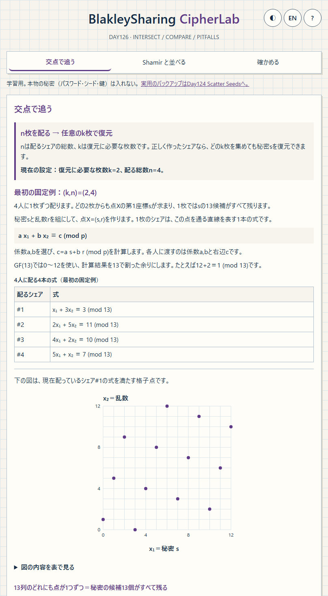
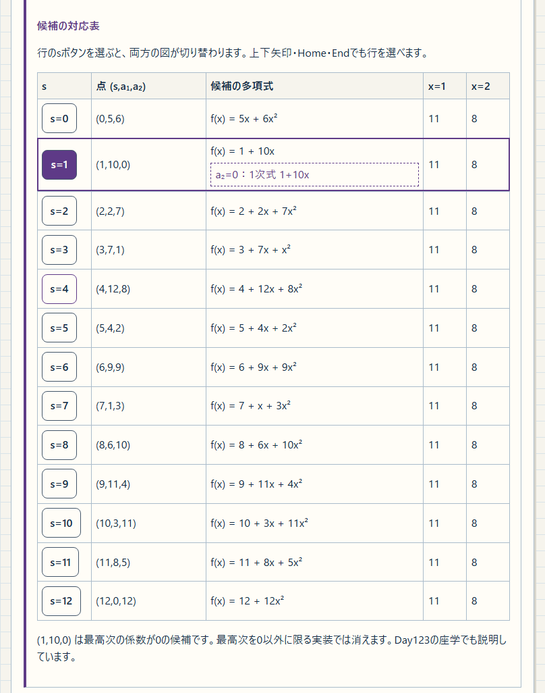
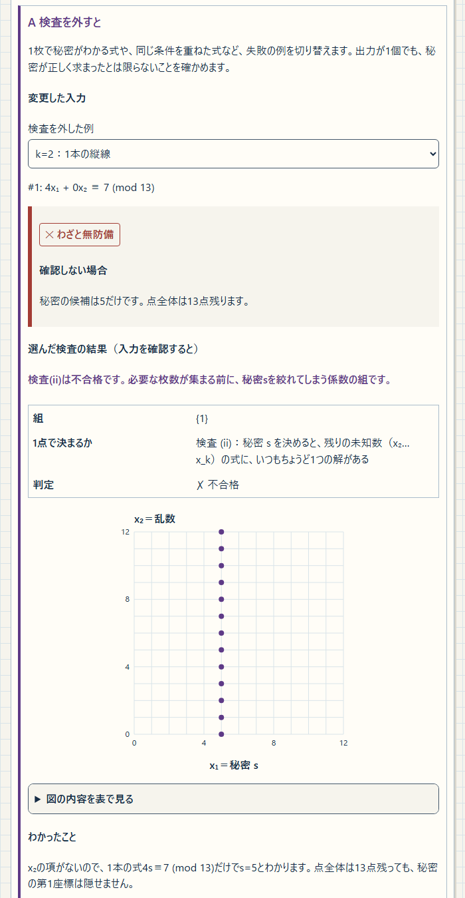

<!--
---
id: day126
slug: blakley-sharing-cipherlab

title: "BlakleySharing CipherLab"
subtitle_ja: "超平面の交点と秘密候補で学ぶBlakleyの秘密分散"
subtitle_en: "Learn Blakley secret sharing through intersections and candidate secrets"

description_ja: "有限体の直線・平面・行列で、Blakleyの秘密分散、Shamirとの対応、乱数と検査の条件を学ぶ教材。"
description_en: "Explore Blakley secret sharing with finite-field geometry, Shamir comparisons, randomness and validation experiments."

category_ja:
  - 現代暗号
  - 情報理論
category_en:
  - Modern Cryptography
  - Information Theory

difficulty: 3

tags:
  - blakley
  - secret-sharing
  - finite-field
  - linear-algebra
  - cryptography-education

repo_url: "https://github.com/ipusiron/blakley-sharing-cipherlab"
demo_url: "https://ipusiron.github.io/blakley-sharing-cipherlab/"
hub: true
---
-->

# BlakleySharing CipherLab - 超平面の交点と秘密候補で学ぶ秘密分散

[English](README.en.md) · 日本語

[](https://github.com/ipusiron/blakley-sharing-cipherlab/stargazers)
[](https://github.com/ipusiron/blakley-sharing-cipherlab/forks)
[](https://github.com/ipusiron/blakley-sharing-cipherlab/commits)
[](LICENSE)
[](https://ipusiron.github.io/blakley-sharing-cipherlab/)

> **Day126 - 生成AIで作るセキュリティツール200**

BlakleySharing CipherLabは、有限体の直線・平面の交点から秘密分散の条件を学ぶ教材です。
シェアを選び、点全体の候補と秘密の第1座標の候補を比べ、Shamirの多項式との対応を追います。

秘密分散は、秘密から複数のシェアを作り、必要な枚数を集めて元の秘密を求める方法です。
シェアは各人に配る情報で、この教材では1本の式に当たります。正しい係数と乱数で作れば、k枚未満から秘密の値を絞れず、任意のk枚以上で復元できます。

学習用。本物の秘密（パスワード・シード・鍵）は入れないでください。
紙への分散保管と復元には、Shamirの秘密分散法を使う別ツール[Day124 Scatter Seeds][day124]があります。Blakley式の実用版ではありません。
ヘルプの「実務用のバックアップツール」に用途と方式の違いを説明しています。ツール内のリンクは別タブで開きます。

## 🌐 デモページ

👉 [BlakleySharing CipherLabを開く](https://ipusiron.github.io/blakley-sharing-cipherlab/)

ブラウザーで利用できます。ダウンロードした`index.html`を`file://`で直接開いても動作し、ビルドは不要です。
画面右上で日本語・英語とライト・ダークを切り替えられます。
テーマは保存した選択を優先し、有効な保存値がなければページを開いた時点のOS設定に従います。
言語とテーマは、それぞれの切り替えボタンを押したときに個別に保存します。

起動中は日本語の説明と日英の準備表示を先に表示し、準備が整うまで操作ボタンを無効にします。
準備が終わると通常の画面になり、言語・明暗の切り替えも使えます。
JavaScriptが無効、または必要なファイルを読み込めない場合も、説明文と折りたたみは読め、再読み込みのリンクが残ります。

## 📸 スクリーンショット

ライトモードの日本語画面です。各画像の下に、その状態で読み取れる内容を示します。



> *ディーラーと4人の受取人を示し、準備・式の作成・配布・復元の順に説明します。秘密と乱数を混ぜて得た余りc=3が、シェア(1,3,3)に入ることを確認できます。*



> *相手が知るのは(1,11)と(2,8)の2枚だけです。13行すべてでf(1)=11、f(2)=8となり、行を選んで同じ2枚に合う候補を比べます。*



> *「確かめる」のカードA。検査を外した模型の出力と、入力を検査した結果を並べます。*

## ✨ できること

| 画面 | 操作と読み取れる内容 |
| --- | --- |
| 交点で追う（k=2） | k=2の直線と、その交点を有限体の座標平面で追う |
| 平面で追う（k=3） | k=3の実数の3D導入図と有限体の切り口で追う |
| Shamirの秘密分散法と比較する | Shamirのシェアを直線・平面の式に書き換え、候補の多項式と点の対応を確かめる |
| 確かめる | 点全体・整数と狭い乱数・検査なし・改ざんの4つを、わざと無防備な模型で比べる |
| ヘルプと座学 | 10節の図表と出典から、原論文との違い、完全性、線形秘密分散まで読む |

有限体はGF(7)、GF(11)、GF(13)です。しきい値kは交点のタブで2、平面のタブで3に固定し、シェア数は`k≤n≤min(8,p−1)`から選べます。
法線は「乱数＋検査」または、番号iから係数(1,i,i²,…)を作る「番号から作る（ヴァンデルモンド）」で生成します。選ぶシェアは0枚からn枚まで切り替えられます。
k=2では右辺や法線の成分を変更し、重なる直線や秘密を明かす縦線も観察できます。

## 📖 使い方と固定教材例

初めてなら、「知っておくべき数学的概念」を必要に応じて開き、k=2の交点を試します。
次に「Shamirの秘密分散法と比較する」で候補の対応を見て、「確かめる」で条件を変えます。k=3の平面と証明は、基本を試した後に進めます。
ヘルプには用語集と読む順があります。座学は1・4・7を先に読むと、方式、候補数、乱数の範囲を確認できます。

### 交点で追う（k=2）

秘密分散とn・kの説明の直後にある「知っておくべき数学的概念」は、最初は閉じた折りたたみです。kの値に関係なく開けます。
GF(13)の固定例で実数・整数・合同式を比べ、下の実験の設定やシェア編集から独立しています。
整数の図は、各座標が0〜12の格子点のうち、`x₁+3x₂=29`を満たす4点です。
modの図は、同じ範囲の全格子点から`x₁+3x₂≡3 (mod 13)`を満たす13点を求めます。

③は「元の直線を折り返す」が初期設定で、補助線を表示します。
①の右下がりの直線を図の外まで延ばし、横も縦も周期13で折り返します。その線上の整数座標の点を取り出すと13点になります。
元の線では、整数点が右へ3・下へ1と並びます。
たとえば`(14,5)→(1,5)`、`(32,−1)→(6,12)`となります。②の4点だけを折り返しても増えないため、範囲外の点も使います。
「別の描き方：x₁の順に描く」では、`x₂≡1+4x₁ (mod 13)`から右へ1・上へ4と進み、x₂を13で折り返します。
`(0,1)→(1,5)→(2,9)→(3,0)`のように、x₁=0〜12の横軸の順に点を置けるため、プロットしやすい方法です。
2つの補助線の経路は異なりますが、点の集合は同じです。GF(13)の点間に連続した線があることを示すものではありません。

nは配るシェアの総数、kは復元に必要な最小枚数です。正しく作ったシェアなら、任意のk枚以上から秘密を復元できます。
図の前に、この関係と現在のp・k・nを表示します。最初の(2,4)例は、4人に1枚ずつ配り、どの2枚でも復元する設定です。
固定例は、ディーラーと4人の受取人を示し、秘密と乱数の用意、式の作成、シェアの配布、復元の順に説明します。
秘密s=5と乱数r=8から点X=(5,8)を作り、秘密と乱数を混ぜた計算結果cをシェアに入れます。
#1では1×5+3×8=29を13で割った余りc=3を求めます。表は、シェアの中身(a,b,c)=(1,3,3)と、その3つの数が表す式を並べます。
1枚で秘密を絞れない理由は、式s+3r≡3を満たす具体例と、どのsでも同じ確率でc=3になることから説明します。
最初の図では、横軸の0〜12の各列に1点ずつあります。どの列にも候補が残るため、秘密sの13候補から1つも除外できません。
折りたたみは、見出しと展開内容を背景・枠で区切り、内容の終わりを示します。
画面にはディーラーの答えも表示しますが、候補数は、集めたシェアと生成条件だけからわかる範囲を数えています。

係数(a,b)の固定値は、#1:(1,3)、#2:(2,5)、#3:(4,2)、#4:(5,1)です。#番号は識別用で、aやbを求める計算には使いません。
k=2では、各bが0以外で、どの2組もmod 13で互いの倍数にならないように選びます。独立で一様なrと合わせて、1枚で秘密を絞れず、2枚で点が決まる条件です。
「係数の選び方を具体例と式で確かめる」では、#1を2倍した(2,6)が新しい条件を増やさない理由と、実際の#2=(2,5)を使う計算を説明します。
係数は秘密や乱数の値に依存させずに決め、固定・公開・再利用できます。乱数rは分け直すたびに独立かつ一様に選び直します。
同じ折りたたみで、条件に合う候補から選ぶ「乱数＋検査」と、k=2で(a,b)=(1,i)を使うヴァンデルモンドも紹介します。

秘密sと乱数rで点`X=(s,r)`を作ります。rは秘密と別に選ぶ補助の数です。
正しい係数の組と、全体から同じ確率で選ぶ乱数を使うことで、1枚の式からsを絞れないようにします。
各人に配るシェアは、この点を通る直線の式`a x₁+b x₂≡c (mod p)`です。
係数a,bを選び、`c=a s+b r (mod p)`を計算します。共通の法pが決まっていれば、a,bと右辺cを渡すことは1本の式を渡すことに相当します。
GF(p)では0〜p−1を使い、計算結果をpで割った余りにします。
初期画面には4枚すべての式を常時表示し、配布と図の関係を追えるようにしています。この4式は固定教材例です。
各タブでp・n・sなどを変更して実験できます。4人に配る初期(2,4)の配布例は、「交点で追う（k=2）」タブだけに表示します。

最初はGF(13)、`k=2`、`n=4`、`X=(5,8)`です。秘密は第1座標の`s=5`です。
シェア#1だけなら、式`x₁+3x₂≡3 (mod 13)`を満たす13点が残ります。
候補を送る操作は、sの値を仮定して対応する乱数の座標を試すものです。答えを入力する操作ではなく、配布値も変わりません。
シェアのボタンを押すと、集めた式へ追加したり、外したりできます。#2を加えると`(5,8)`の1点に定まります。
点の数字は、そこで重なる式の数です。0枚ではすべての点が候補ですが、シェアの点をまだ描かないため図は空欄になります。
右辺cや係数bの変更は、実験用の写しだけに反映します。編集後の交点から読む値は、元の秘密と一致するとは限りません。
座標図へマウスカーソルを置くと、最寄りの格子点の座標を表示します。図から離れるかEscapeで表示を消せます。
キーボードでは「図の内容を表で見る」から値を確認できます。タッチ操作では、図の上でも縦にスクロールできます。

<!-- example: default-k2 -->

| シェア | 法線 (a₁,a₂) | c (mod 13) | 整数の右辺 |
| --- | --- | --- | --- |
| #1 | (1,3) | 3 | 29 |
| #2 | (2,5) | 11 | 50 |
| #3 | (4,2) | 10 | 36 |
| #4 | (5,1) | 7 | 33 |

「ディーラーの設定・計算・配布」には答えと生成の設定があります。p・n・sを変えるとシェアを作り直します。
配布表の各行には、1人に渡すシェアの中身を表示します。係数を順に並べ、最後に右辺cを入れた組です。法pは全員で共通です。
pを小さくしてsやnが扱える範囲を外れた場合は、調整前後の値と理由を表示します。
「新しい乱数で作る」はsを保ち、乱数の座標を選び直します。「乱数＋検査」では係数も選び直し、試行回数を表示します。「番号から作る」では、同じp・k・nなら係数は変わりません。
乱数の座標を手入力すると、sと係数を保って各シェアの右辺cを計算し直します。手入力では、一様な乱数を選ぶ前提を確認できません。入力中に画面幅が変わっても値を保持し、入力を確定したときに計算へ反映します。
「すべての写しを元に戻す」は、全シェアの写しに加えた編集を取り消し、元の配布値に戻します。
法線の検査はすべての対象の組を調べます。(i)はk枚からの復元、(ii)は乱数の前提の下でk−1枚から秘密を絞れないための係数を確認します。
式や検査の詳細は折りたたみを開いて読めます。

### 平面で追う（k=3）

「平面で追う（k=3）」タブでは、点の座標を3つに増やした実験を扱います。
「交点で追う（k=2）」と行き来しても、それぞれの実験で選んだシェアや候補、「不合格だけ」の設定を保持します。「このタブの既定の例に戻す」を押すと、直線のタブではk=2、平面のタブではk=3の初期状態へ戻ります。

k=3の固定例はGF(11)、`X=(7,2,9)`です。#1・#2では、11個の秘密候補の切り口に各1点が残ります。
#3を加えると、`s=7`の切り口の`(x₂,x₃)=(2,9)`だけが残ります。

<!-- example: default-k3 -->

| シェア | 法線 (a₁,a₂,a₃) | c (mod 11) |
| --- | --- | --- |
| #1 | (1,2,3) | 5 |
| #2 | (4,1,5) | 9 |
| #3 | (2,7,1) | 4 |
| #4 | (3,1,1) | 10 |
| #5 | (1,1,3) | 3 |

3Dの実数図は導入図です。有限体の切り口とは同じsで連動しますが、交点の座標は一般には一致しません。
有限体の候補数はGF(p)の切り口と表で読みます。実数図は整数の右辺で描いています。
平面の表示を切り替えても、計算に使うシェアの枚数は変わりません。
各切り口の札はsを固定したときの共通候補だけを示します。大きな図では各式だけを満たす点も描くため、札が「点なし」でも点が残る場合があります。
2枚以上を選んだとき、全式の共通候補は二重丸と重なる枚数で示します。復元されたsと、いま見ている切り口が異なる場合は、復元先へ移るボタンを使えます。

### Shamirの秘密分散法と比較する

Shamir方式は、たとえば`f(x)=s+a₁x`という式を作り、秘密を`f(0)=s`に置きます。
各人へ渡すのは、0以外の番号iと計算値f(i)の組です。a₁は乱数で、k=3では乱数a₂を加えた`f(x)=s+a₁x+a₂x²`を使います。
配るシェアには、秘密と乱数を混ぜた計算結果f(i)を入れ、sやa₁・a₂そのものは渡しません。
係数を座標として並べ、k=2ではX=(s,a₁)、k=3ではX=(s,a₁,a₂)と定義します。Xはシェアの点(i,f(i))とは別の点です。
シェア(2,8)を例に、f(2)=8からs+2a₁+4a₂≡8、さらにx₁+2x₂+4x₃≡8 (mod 13)へ書き換えます。
これが点Xを通る平面の条件です。この比較では、式の係数(1,i,i²)を番号iから計算できます。

k=2の配布側の答えは、[Day123 ShamirSharing CipherLab][day123]の導入と同じ`f(x)=5+4x (mod 13)`です。
相手が知るのは(1,9)の1枚だけです。この点を通る13本の候補の直線が、`s+a₁≡9`を満たす13点`(s,a₁)`に対応します。
次の表は、答えの確認用に配布側の5枚すべてを示します。画面では全配布値と元の多項式を「配布側の答えを見る」に分けています。

<!-- example: shamir-k2 -->

| i | f(i) (mod 13) |
| --- | --- |
| 1 | 9 |
| 2 | 0 |
| 3 | 4 |
| 4 | 8 |
| 5 | 12 |

k=3の配布側の答えは`f(x)=5+4x+2x² (mod 13)`、係数の点は`X=(5,4,2)`です。
相手が知るのは(1,11)と(2,8)の2枚だけで、必要な3枚には足りません。この2枚に合う、次の13点と13個の多項式が残ります。
表のsを選ぶと、多項式の図と切り口の図が同時に切り替わります。どれも同じ候補の別の表し方です。

<!-- example: shamir-k3 -->

| s | (s,a₁,a₂) | 候補の多項式 (mod 13) | f(1) | f(2) |
| --- | --- | --- | --- | --- |
| 0 | (0,5,6) | `f(x)=5x+6x^2` | 11 | 8 |
| 1 | (1,10,0) | `f(x)=1+10x` | 11 | 8 |
| 2 | (2,2,7) | `f(x)=2+2x+7x^2` | 11 | 8 |
| 3 | (3,7,1) | `f(x)=3+7x+x^2` | 11 | 8 |
| 4 | (4,12,8) | `f(x)=4+12x+8x^2` | 11 | 8 |
| 5 | (5,4,2) | `f(x)=5+4x+2x^2` | 11 | 8 |
| 6 | (6,9,9) | `f(x)=6+9x+9x^2` | 11 | 8 |
| 7 | (7,1,3) | `f(x)=7+x+3x^2` | 11 | 8 |
| 8 | (8,6,10) | `f(x)=8+6x+10x^2` | 11 | 8 |
| 9 | (9,11,4) | `f(x)=9+11x+4x^2` | 11 | 8 |
| 10 | (10,3,11) | `f(x)=10+3x+11x^2` | 11 | 8 |
| 11 | (11,8,5) | `f(x)=11+8x+5x^2` | 11 | 8 |
| 12 | (12,0,12) | `f(x)=12+12x^2` | 11 | 8 |

<!-- example: nonzero -->

`(1,10,0)`は`a₂=0`の1次式`1+10x`です。最高次の係数だけを非零に限ると、この候補が消えます。
このツールの「乱数の座標を0以外に限る」はa₁とa₂の両方を制限します。
そのため`s=1`と`s=12`が消え、候補は13個から11個になります。
有限体の計算点は離散的で、点を結ぶ補助線は並びの目安です。

### 確かめる

カードはB→C→A→Dの順です。各カードの操作目的を読み、入力を変えた結果と、その理由を比べます。
Bは秘密を点全体とするか第1座標だけとするか、Cは生成条件の違いを比べます。A・Dでは確認を省く模型と、式の条件を調べる結果を並べます。

- B：点全体を秘密にすると、独立なシェア1枚ごとに候補がp分の1になる
- C：整数の範囲や狭い乱数から、秘密の候補が減る
- A：検査を外すと秘密が漏れたり、1点に定まらない式から値を返したりする
- D：#2の右辺を変え、集める枚数による検出・特定の違いを調べる

Bでは0枚から順に増やし、点全体の候補数と、秘密sの候補数の減り方を見ます。
点全体は座標の組の数、秘密sは第1座標の種類数です。k=3の2枚では点が11個になっても、sは0〜10の11種類が残ります。
切り口の各札はsを固定した図です。すべての札の点を足すと点全体の候補数、点がある札を数えるとsの候補数になります。
このカードの札は表示専用です。「平面で追う（k=3）」タブの札は選択でき、選んだ切り口を大きく表示します。
Cの対照例は、初めからmod 13で配り、乱数をGF(13)全体から一様に選ぶ方式です。後から検査して、すでに漏れた情報を消す操作ではありません。
整数の例は`X=(5,8)`のまま、座標を0〜12に限り、右辺をmod 13で減らさず配ります。

<!-- example: integer -->

| シェア | 整数の右辺 | 秘密sの候補 |
| --- | --- | --- |
| #1 | 29 | {2,5,8,11} |
| #2 | 50 | {0,5,10} |
| #3 | 36 | {3,4,5,6,7,8,9} |
| #4 | 33 | {5,6} |

#1は`s≡2 (mod 3)`という合同式、#4は乱数座標の範囲によって候補が絞られます。
狭い乱数の例は、`x₂∈{0,1,2,3}`から作った別の固定例です。1枚から残る秘密は次の4候補です。

<!-- example: narrow -->

| 生成したX | 法線 | c (mod 13) | 秘密sの候補 |
| --- | --- | --- | --- |
| (0,1) | (1,3) | 3 | {0,3,7,10} |

<!-- example: leak3 -->

Aのk=3の例では、法線`(1,2,3)`と`(5,4,6)`、右辺`c=(5,9)`を使います。
第2の式から第1の式の2倍を引くと`3s≡10 (mod 11)`となり、`s=7`が確定します。
点全体は11点残るため、点が一意でないことだけでは秘密の保護を説明できません。
Aの同一直線の例は、2枚あっても同じ条件を重ねただけです。クラメルの計算や合格率の数値は「計算の詳細」に残し、常時表示の理由と分けています。

Dでは、最初の教材例の#2の右辺を11から12へ変えます。

<!-- example: tamper -->

| 選ぶ2枚 | 復元されるX | s |
| --- | --- | --- |
| #1 + #2 | (8,7) | 8 |
| #1 + #3 | (5,8) | 5 |
| #1 + #4 | (5,8) | 5 |
| #2 + #3 | (0,5) | 0 |
| #2 + #4 | (1,2) | 1 |
| #3 + #4 | (5,8) | 5 |

#1・#2の2枚では誤った点`(8,7)`を受理します。#1・#2・#3の3枚では不一致を検出できますが、悪い1枚を特定できません。
4枚では`(5,8)`が3回現れ、#2だけがその点を通らないとわかります。
条件は、変更が1枚、正しい法線が検査(i)を満たすこと、全対象の組を調べること、変更した直線が元のXを通らないことです。
一般に、この独立性のもとで最大t枚の誤りを訂正するには、`k+2t`枚あれば足ります。
ここで調べるのは式どうしの一致であり、送信者の認証や、シェアが一度も書き換えられていないことの保証ではありません。
Dではδを0にすると変更なしへ戻せます。線形性とすべてのδの計算表は「計算の詳細」で確認できます。

<!-- example: linearity -->

#1・#2から秘密を読む係数は`u=(8,3)`で、`s=8c₁+3c₂ (mod 13)`です。
#2の右辺をδだけ変えると、計算されるsは`3δ`だけ変わります。δ=1なら計算値は5から8になり、元の秘密5とは異なります。
このuは、点X全体の変化を表すベクトルではありません。
Shamirも線形ですが、Blakleyの素朴なシェアには法線も含まれ、その成分を変更する余地があります。

## 🔬 方式の条件と原論文

### 秘密を第1座標に置く条件

点を`X=(s,r₂,…,rₖ)`とし、法線aᵢと右辺`cᵢ=aᵢ·X`をシェアにします。
このツールでは、生成時に次の2つを検査します。

| 検査 | 条件 | 得られる性質 |
| --- | --- | --- |
| (i) | どのk本の法線も独立 | 任意のk枚から点Xを復元できる |
| (ii) | どのk−1本もe₁=(1,0,…,0)を加えると独立 | 下記の乱数の前提で、k−1枚以下からsの情報が増えない |

x₂…x_k は GF(p) 全体（0を含む）から一様に、秘密ごとに新しく、法線とは別に選ぶ。
法線は公開・使い回してよい。使い回してはならないのは x₂…x_k

乱数の座標同士も独立に選びます。法線の選び方は秘密に依存させず、点Xや右辺を見て引き直しません。
選んだ法線の行空間にe₁が入ればsが求まり、入らなければ各sに同じ数の等確率の解が対応します。
この説明は[BeimelのClaim 2][beimel]に基づく、このツールでの整理です。

法線`(1,i,…,i^(k−1))`と異なる非零のiを使えば、Shamirのシェアの式になります。
この具体的なヴァンデルモンドによる対応を明示した一次資料は、今回の調査では見つかっていません。
ここでは式を展開したこのツールでの整理として説明します。

### 点全体と秘密の候補数

検査(i)(ii)を満たす固定例の候補数です。独立なm枚で点全体は`p^(k−m)`個になります。
秘密を第1座標だけに置く場合、m<kのあいだはp個すべてが残ります。

<!-- example: whole-point -->

| k | p | 選択枚数 | 点全体の候補数 | 秘密sの候補数 |
| --- | --- | --- | --- | --- |
| 2 | 13 | 0 → 1 → 2 | 169 → 13 → 1 | 13 → 13 → 1 |
| 3 | 11 | 0 → 1 → 2 → 3 | 1331 → 121 → 11 → 1 | 11 → 11 → 11 → 1 |

[Handbook of Applied Cryptography（HAC）][hac]の§12.10 Notes、pp.538–539には、次の記述があります。

> While Shamir's threshold scheme is perfect, Blakley's vector scheme is not (the set of possible values of the shared secret narrows as subsequent shares are added).

これは点全体の版で起きる候補の減少と合います。この対応はこのツールでの読みです。
HACが参照するのは1979年の射影による方式であり、このツールの第1座標版の条件を述べたものとしては扱いません。
Wikipediaの「1座標だけなら内部の者は外部の者と同じ」という説明も、検査(ii)なしには成り立ちません。

### 1979年の原文と発展する理論

ShamirとBlakleyは1979年にしきい値法を独立に提案しました。
[Blakleyの原論文][blakley]は、鍵を無作為な位置の成分に置き、別の無作為な位置の成分を1にしたベクトルを含む、原点を通る超平面を配ります。
復元するのは原点を通る直線、すなわち射影空間の点です。原文の記号は`k=b+1`、`n=a+b+1`で、空間は`k+1`次元です。
復元後も鍵の候補を試す前提があり、候補数はp.316で`b+2`、p.317で`(b+1)(b+2)`と一致しません。
安全性は“unproven but plausible”とする仮定に依存します。
原文の「第1検査・第2検査」は行列Mの成分や小行列式の検査で、このツールの検査(i)(ii)とは別です。
原文の方式は座学で紹介するだけで、実装していません。

任意のk行が独立な`[e₁;A]`はMDS符号と関係します。
pが素数で`2≤k≤p`なら、[Ball 2012][ball]の上限から`n≤p`となります。
k=2は射影直線の点を数えればわかり、k=3・奇素数pの結果はBose 1947に由来しますが、Boseの本文は未確認です。
UIの`p−1`はヴァンデルモンドにそろえた選択で、`n=p`が不可能という意味ではありません。

コーシー行列は別の構成法として座学だけで紹介します。
また、誰がe₁を作れるかを行列で決める線形秘密分散と、モノトーン・スパン・プログラム（MSP）への対応を座学8で説明します。

## 📏 シェアの大きさ

秘密を0〜p−1の数m個で表し、`k=3`とした場合です。体の要素1個は、この数1個を指します。
式全体に0以外の数を掛けて係数の1つを1にそろえる操作を、正規化と呼びます。その1を省略する、概念上の体の要素数を比べます。

<!-- example: share-size -->

| 方式 | 体の要素数 | m=1 | m=16 |
| --- | --- | --- | --- |
| 秘密の要素ごとに法線を作る | mk | 3 | 48 |
| 法線1組を再利用する | m+k−1 | 3 | 18 |
| Shamir（番号は公開） | m | 1 | 16 |

未正規化の1式をそのまま保存するなら、法線k要素と右辺1要素です。
表では公開の番号と、正規化で1にした成分の位置情報を除きます。保存するバイト数の比較ではありません。
法線を再利用しても、各秘密要素の乱数の座標は新しく選びます。
法線を公開の番号から決めれば、配る値は右辺だけになり、Shamirと同じ大きさになります。

## 🎯 ユースケース

このツールならではの使い方

- 線形代数の授業：教員がk=3で2枚から3枚へ切り替え、11個の切り口に各1点ある状態が1点だけになる様子を、階数と自由変数の説明に使う
- 情報理論の演習：学習者が点候補169→13→1と秘密候補13→13→1を比べ、「解が複数ある」と「秘密の確率が変わらない」の違いを考える
- 合同式のパズル：出題者が整数の#1から{2,5,8,11}を求める問題と、狭い乱数から{0,3,7,10}を求める問題を並べ、異なる前提を読み解く練習にする
- 冗長データの検査研修：開発者が2・3・4枚の改ざん例を比べ、不一致の検出と原因の特定が別の条件を要することを学ぶ。実際の送信者認証を代替する例ではない
- 多項式と幾何学の講義：教員が(1,10,0)と1+10xの対応を示し、非零制限で13行が11行になることから、乱数分布も方式の条件であると説明する

自習ではヘルプの証明と画面の各切り口を交互に確認できます。
CTFや謎解きの作問では、教材の小さな数を使って問題の期待値を確かめられます。
実装レビューや調査では、有限体・乱数の範囲・全組の検査・復元時の階数を確認する観点を得られます。
家庭や勉強会で秘密分散を説明する導入にも使えますが、実際の鍵の分割・印刷・保管は扱いません。

## 🔎 先行例との違い

2026年10月24日の調査で本文を確認した資料との比較です。網羅的な一覧や、唯一の実装という主張ではありません。

| 観点 | 確認した先行例 | このツールで扱う内容 |
| --- | --- | --- |
| 図と候補 | [Wikipediaの静的な図と説明][wikipedia] | GF(p)の点と切り口を操作し、残る秘密候補を数える |
| 一般の位置 | [darrelllongの作者による制限の説明][darrell-theory] | 最初のk枚だけでなく、全対象の組の検査結果を表にする |
| Shamirとの関係 | [UIC CS594第8回の講義資料][uic]とWikipedia | 同じ固定例の多項式・係数の点・13行の表を連動させる |

WikipediaとUICは理論の説明としては二次資料です。UICはPDFの文字を確認しましたが、数式の抽出には一部不完全さがあり、図の有無は未確認です。
darrelllongのコードとTHEORY.mdは、作者の実装についての一次資料として確認しました。

狭い乱数の実例は、[pyquorumの作者による公表][pyquorum]を参照しています。
0.3.0より前の版で、体の幅より狭い乱数からLLLにより復元されたという報告です。
この教材の4候補の例は原理を示す小さな模型で、LLL攻撃を実装したものでも、現在の版への攻撃結果でもありません。

## 🔗 関連ツール

| ツール | 題材・用途 | Day126との違い・対応 |
| --- | --- | --- |
| [Day123 ShamirSharing CipherLab][day123] | GF(p)の座標平面とGF(2⁸)のバイトによる学習 | シェアは多項式上の点。Day126はシェアを超平面、係数を点として読む |
| [Day070 VisualCryptography CipherLab][day070] | 2枚の画像を重ねる視覚暗号 | 画像を重ねて目で復元する方式。Blakleyの連立方程式による方式とは別 |
| [Day124 Scatter Seeds][day124] | Shamirの秘密分散で紙に分け、保管・復元する | Blakley式の実用版ではなく、方式が異なる別ツール |
| [Day125 Overlay QR Shares][day125] | 視覚暗号とQRの重ね合わせ | 画像を重ねる復元と、有限体の求解を比べられる |
| [Day029 OTP Animation][day029] | ワンタイムパッドとXORの仕組み、完全秘匿性 | 暗号文から平文が決まらないOTPと、k−1枚から秘密の確率が変わらない性質を比べられる |

## 🔒 セキュリティと制約

- 計算と入力の処理はブラウザー内で完結。外部API、CDN、解析用の外部送信は使用しない
- CSPは`connect-src 'none'`を含み、スクリプトとスタイルは同一配信元のファイルだけを許可
- 保存するのは言語と明暗の設定だけ。秘密・法線・シェアはlocalStorageに保存しない
- 乱数生成は`crypto.getRandomValues`を使用し、棄却法で偏りを避ける。生成失敗時は前の例を保持して操作可能な状態に戻す
- 危ない模型は`pitfalls.js`に分離。検査付きの計算部`gf-core.js`は、この模型を呼び出さない
- 小さい有限体の学習用。実データの書式・印刷・QR・認証・保管・実用暗号の保証は提供しない

公開ページの読み込みと、参考資料へのリンクを開く操作には通常の通信が発生します。
入力を送信する機能はありません。原論文の射影形、コーシーによる生成、GF(2⁸)のバイト分割はこのツールの実装範囲外です。

## 🧪 テスト

Node.js 22以上で、依存パッケージを追加せずに実行できます。

```sh
npm test
```

- 有限体の逆元・階数・掃き出し、既定の全組の復元、生成の既知値と棄却動作
- 候補数、整数と狭い乱数、Shamir対応、改ざんとδによる秘密の変化
- 日英辞書と静的な日本語本文の一致、禁止語、CSP、保存範囲、配色、ソース形式
- READMEの数値表・YAML・見出し対応・ディレクトリー構造・画像
- `theme-init.js`のOS設定・保存値・保存領域の例外・初期保存なし・headでの同期読み込み

GitHub Actionsはpushとpull requestで、Node.js 22による構文確認と`npm test`を実行します。
ブラウザー検査はローカルのPython＋Playwrightで行います。PlaywrightとChromium・Firefoxを用意して実行してください。

```sh
python test/interface.browser.py --stage 1c
```

file://とHTTP、幅320・390・1280px、日英、明暗、タブ、キーボード操作、3D回転、比較表、4カード、ヘルプを確認します。
ローカルのブラウザー検査は46ケースが成功し、乱数生成失敗後の復帰も4ケースを追加確認しています。
起動時の表示は、次の検査で14条件を確認します。読み込みを遅らせた状態、JavaScript無効、スクリプトの読み込み失敗、設定の保存拒否などで、説明の表示と操作の無効化・解除を調べます。
言語・テーマボタンを実際に押し、それぞれの設定だけを保存することと、再読み込み時のテーマ選択も確認します。
一時的なローカルHTTPサーバーを起動し、結果を`.work/`に保存します。

```sh
python test/startup.browser.py
```

READMEや画像の検査を含むNodeテストの件数は、実行結果で確認できます。

## 📚 出典と確認範囲

本文確認と書誌確認を区別しています。式の対応や有限体の具体例は、記載した文献と参照実装の値からこのツールで整理したものです。

- [G. R. Blakley, “Safeguarding cryptographic keys”][blakley]。
  AFIPS 1979 NCC, Vol.48, pp.313–317。一次・本文確認。
  DOIは10.1109/MARK.1979.8817296を使用。10.1109/AFIPS.1979.98も同じ論文を指す
- [A. Shamir, “How to share a secret”][shamir]。
  CACM 22(11), pp.612–613, 1979。一次・書誌確認。この調査では原論文本文は未確認
- [Menezes・van Oorschot・Vanstone, Handbook of Applied Cryptography][hac]。
  1996、第12章、特に§12.10 Notes、pp.538–539。二次・本文確認
- [A. Beimel, “Secret-Sharing Schemes: A Survey”][beimel]。
  IWCC 2011, LNCS 6639, pp.11–46、[DOI][beimel-doi]。二次・Claim 2とRemark 2の本文確認
- [S. Ball, “On sets of vectors of a finite vector space in which every subset of basis size is a basis”][ball]。
  JEMS 14(3), pp.733–748, 2012。一次・要旨と冒頭確認、証明本文は未精査
- R. C. Bose, 1947, Sankhyā 8, pp.107–166。書誌は二次資料で確認、原論文本文は未確認
- [E. F. Brickell, “Some Ideal Secret Sharing Schemes”][brickell]。
  EUROCRYPT ’89, LNCS 434, pp.468–475。一次論文の書誌確認、本文未確認
- [M. Karchmer・A. Wigderson, “On span programs”][kw]。
  Structure in Complexity Theory 1993, pp.102–111。一次論文の書誌確認、本文未確認
- [Kothari, “Generalized Linear Threshold Scheme”][kothari]。
  CRYPTO ’84, LNCS 196, pp.231–241（1985年刊）。書誌確認のみ、本文・要旨とも未確認
- [Wikipedia “Secret sharing”][wikipedia]（確認版revid 1379678799）、[UIC CS594 Lecture 8][uic]、[darrelllongのREADME][darrell]。
  Shamirとの関係についての二次資料として本文確認。[Cauchy matrix][cauchy]も二次資料として参照
- [pyquorumのセキュリティ記録][pyquorum]。一次・作者が公表した本文を確認

## 📁 ディレクトリー構造

```text
blakley-sharing-cipherlab/  # プロジェクトのルート
├── .gitattributes                   # 改行とPNGの属性
├── .github/                         # GitHub用の設定
├── .github/workflows/               # 継続的検査の定義
├── .github/workflows/test.yml       # Node.js 22による構文確認とテスト
├── assets/                          # 日本語の画面画像
├── assets/screenshot.png            # 日本語の交点画面
├── assets/screenshot2.png           # 日本語のShamir比較表
├── assets/screenshot3.png           # 日本語の検査なしカードA
├── assets/en/                       # 英語の画面画像
├── assets/en/screenshot.png         # 英語の交点画面
├── assets/en/screenshot2.png        # 英語のShamir比較表
├── assets/en/screenshot3.png        # 英語の検査なしカードA
├── test/                            # 自動テストと固定値
├── test/contrast.test.js            # 文字と背景の配色検査
├── test/core.test.js                # 計算・生成・復元・危ない模型の検査
├── test/format.test.js              # 公開ソースの形式検査
├── test/i18n.test.js                # 日英辞書・静的な日本語本文・用語の検査
├── test/interface.browser.py        # ChromiumとFirefoxの画面操作検査
├── test/readme.test.js              # READMEの数値・構造・画像検査
├── test/startup.browser.py          # 読み込み中・失敗時・完了時の表示と操作の検査
├── test/structure.test.js           # 画面構造・CSP・保存範囲の検査
├── test/theme-init.test.js          # 初期テーマ判定・保存例外・同期読み込みの検査
├── test/vectors.json                # 参照実装から得た固定の期待値
├── app.js                           # 画面状態・図・表・操作の制御
├── gf-core.js                       # 有限体・検査・生成・復元の計算
├── index.html                       # 画面の構造とヘルプの座学
├── LICENSE                          # MITライセンス
├── messages.js                      # 日本語と英語の辞書
├── package.json                     # プロジェクト情報とテストコマンド
├── pitfalls.js                      # 検査を省いた教材用の模型
├── README.md                        # 日本語の説明書
├── README.en.md                     # 英語の説明書
├── style.css                        # 画面・テーマ・狭い幅のレイアウト
└── theme-init.js                    # 最初の描画前のテーマ判定
```

## 💻 動作環境

HTML・CSS・通常のJavaScriptだけで動作します。ビルドツールや実行時の外部ライブラリーは不要です。
ローカルでは`index.html`を開くか、次のようにHTTPで配信できます。

```sh
python -m http.server 8000 --bind 127.0.0.1
```

[ローカルページ](http://127.0.0.1:8000/)を開いてください。
確認済みブラウザーはChromiumとFirefoxです。JavaScript、SVG、dialog、Web Cryptoを使います。
Node.jsは自動テスト用、PythonとPlaywrightはローカルのブラウザー検査用で、通常の利用には不要です。

## 📄 ライセンス

[MIT License](LICENSE)。Copyright (c) 2026 ipusiron。
実行時の外部ライブラリーはありません。図・画面・説明を利用する際は、同ライセンスの条件に従ってください。
引用した文献・外部資料には、それぞれの権利が適用されます。

## 🛠️ このツールについて

本ツールは、「生成AIで作るセキュリティツール200」プロジェクトの一環として開発されました。
このプロジェクトでは、AIの支援を活用しながら、セキュリティに関連するさまざまなツールを100日間にわたり制作・公開しています。
プロジェクトの詳細とほかのツールは、次のページをご覧ください。

[生成AIで作るセキュリティツール200](https://akademeia.info/?page_id=44607)

[blakley]: https://doi.org/10.1109/MARK.1979.8817296
[shamir]: https://doi.org/10.1145/359168.359176
[hac]: https://cacr.uwaterloo.ca/hac/about/chap12.pdf
[beimel]: https://www.cs.bgu.ac.il/~beimel/Papers/Survey.pdf
[beimel-doi]: https://doi.org/10.1007/978-3-642-20901-7_2
[ball]: https://doi.org/10.4171/JEMS/316
[brickell]: https://doi.org/10.1007/3-540-46885-4_45
[kw]: https://doi.org/10.1109/SCT.1993.336536
[kothari]: https://doi.org/10.1007/3-540-39568-7_19
[wikipedia]: https://en.wikipedia.org/wiki/Secret_sharing
[cauchy]: https://en.wikipedia.org/wiki/Cauchy_matrix
[uic]: https://www.cs.uic.edu/~block/courses/cs594-spring2026/docs/lecture8.pdf
[darrell]: https://github.com/darrelllong/secret-sharing
[darrell-theory]: https://github.com/darrelllong/secret-sharing/blob/main/THEORY.md
[pyquorum]: https://github.com/svvqt/pyquorum/blob/main/SECURITY_ISSUES_TRACKER.md
[day123]: https://ipusiron.github.io/shamir-sharing-cipherlab/
[day070]: https://ipusiron.github.io/visual-cryptography-cipherlab/
[day124]: https://ipusiron.github.io/scatter-seeds/
[day125]: https://ipusiron.github.io/overlay-qr-shares/
[day029]: https://ipusiron.github.io/otp-animation/
